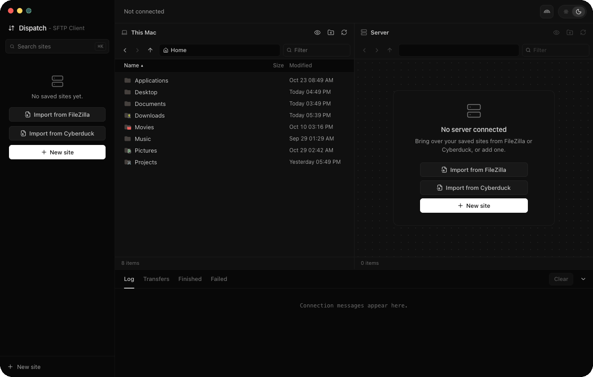

<picture>
  <source media="(prefers-color-scheme: dark)" srcset="docs/title-dark.png">
  
</picture>

Dispatch is a fast, lightweight, open-source SFTP and FTP client for macOS. Browse local and remote files side by side, manage transfers with a built-in queue, and import your saved connections from FileZilla and Cyberduck in one click.



It is built with [Tauri 2](https://tauri.app): a Rust backend for the connections and transfers, and a React frontend for the interface. The app is about 12 MB, 7 MB as a zip download.

## Why Dispatch

- **Fast and native.** A real macOS app built in Rust, about 12 MB, that opens instantly. No Electron and no bundled browser.
- **Free and open source.** No account, no subscription and no telemetry. GPL-3.0 licensed.
- **A modern FileZilla and Cyberduck alternative for Mac.** Import your existing sites in one click and keep working.
- **Local and remote side by side.** Two file panes, drag and drop, and a transfer queue that keeps browsing responsive while files move.

## Features

- **Protocols:** SFTP, FTP (with TLS when the server supports it), FTPES (explicit TLS), FTPS (implicit TLS) and plain FTP.
- **SFTP login:** password, key file (OpenSSH or PuTTY `.ppk`, with or without a passphrase), ssh-agent, and keyboard-interactive for servers that only allow that.
- **FileZilla import:** reads FileZilla's Site Manager (`~/.config/filezilla/sitemanager.xml`, or a file exported from FileZilla) and keeps folders, colors, remote folders, key files and saved passwords. Passwords protected by a FileZilla master password cannot be read; Dispatch asks for them on the first connect.
- **Cyberduck import:** reads Cyberduck's bookmarks (or `.duck` files dragged out of Cyberduck) and keeps names, hosts, ports, usernames, remote and download folders, key files, and the first label as the group. Cyberduck keeps passwords in the Keychain, not in its bookmarks, so Dispatch asks for each password on the first connect.
- **Keychain:** passwords and key passphrases are stored in the macOS Keychain, not in plain text. A key passphrase is stored once per key file and used by every site with that key.
- **File panes:** sorting, filtering, breadcrumbs, back and forward, hidden files on or off, keyboard navigation and type-to-select.
- **Drag and drop:** between the two panes, from Finder onto the remote pane, and onto folders within a pane to move files.
- **Transfer queue:** two transfers at a time on their own connections, so browsing stays responsive. Shows progress and speed, with cancel and retry. Folders upload and download recursively.
- **Existing files:** ask, overwrite, overwrite if the size differs, or skip. Downloads are written to a temporary file and renamed when complete.
- **Remote files:** rename, delete (folders recursively), change permissions and create folders. Local files are moved to the Trash.
- **Host keys:** SSH host keys are trusted the first time a server is seen. If a key changes later, Dispatch refuses to connect until you confirm the new key.
- **Log:** connection steps and errors, with syntax colors.
- **Appearance:** light and dark theme, and five file icon sets.

**Interface**

- The same design as [Lookout](https://github.com/lakiAlex/lookout): a title bar across the window, an icon sidebar, a side panel and the file panes on a rounded surface. Icons are [Hugeicons](https://hugeicons.com).
- The title bar shows the connected site, its protocol and `user@host`, with Connect or Disconnect, the window layout button and the light and dark switch on the right.
- The sidebar has Sites, Transfers (with the number of running transfers), New site and Import from FileZilla or Cyberduck. It minimizes to a narrow strip with small icons.
- The Sites panel lists saved sites by folder, with search (⌘K). The connected site is marked in green. The panel can be closed and resized by dragging its edge.
- The window layout button opens a panel with four layouts, as in the Rectangle app: left half, right half, center and fill the screen. Clicking left or right again steps the width through 1/2, 2/3 and 1/3, clicking center again makes the window larger, and clicking fill again puts the window back where it was.
- The ... button at the bottom of the sidebar has light and dark mode, the file icon set and memes.
- The cat button in the corner shows a random meme from Reddit through [meme-api.com](https://github.com/D3vd/Meme_Api), skipping posts marked NSFW. Settings > Memes turns it off.

## Keyboard shortcuts

| Keys | Action |
| --- | --- |
| ⌘K | Search sites (opens the Sites panel) |
| ⌘1, ⌘2 | Focus the local pane, the remote pane |

## Install

With Homebrew:

```sh
brew install --cask lakialex/tap/dispatch
```

Or download `Dispatch-SFTP_<version>_aarch64.dmg` from [Releases](../../releases), open it, and drag `Dispatch SFTP` into the Applications folder. The build is for Apple Silicon Macs and needs macOS 11 or later. A `.app.zip` is attached too, if you prefer that.

The app is not signed with an Apple Developer certificate or notarized, so the first time you open a download macOS says it cannot be verified. Either right-click the app and choose Open, then confirm once, or run:

```sh
xattr -dr com.apple.quarantine "/Applications/Dispatch SFTP.app"
```

The Homebrew cask does this for you.

## Build from source

Requirements: [Rust](https://rustup.rs) (stable), Node.js 20 or later, and [pnpm](https://pnpm.io).

```sh
pnpm install
pnpm tauri dev                  # run in development mode
pnpm tauri build --bundles app  # build src-tauri/target/release/bundle/macos/Dispatch SFTP.app
```

## Tests

```sh
cd src-tauri
cargo test
```

`src-tauri/src/remote/live_tests.rs` has round-trip tests (upload, download, rename, permissions, delete, cancel) against real FTP, FTPES and SFTP servers. They are ignored by default. The comment at the top of the file lists the servers and keys they expect.

## Project layout

| Path | Contents |
| --- | --- |
| `src-tauri/src/remote/` | FTP (`suppaftp`) and SFTP (`russh`) connections |
| `src-tauri/src/transfer.rs` | Transfer queue and workers |
| `src-tauri/src/import/` | FileZilla and Cyberduck import |
| `src-tauri/src/commands.rs` | Commands called by the frontend |
| `src/components/Sidebar.tsx` | Sidebar icons and the Sites panel |
| `src/components/WindowSnap.tsx` | The window layout button, shared with Lookout and Cells |
| `src/components/` | Interface |
| `src/icons/` | File icon sets |
| `src-tauri/icons/` | App icon. `build-icon.sh` rebuilds the macOS 26 icon. |

## Data

- Sites: `~/Library/Application Support/com.laki.dispatch/sites.json`
- Trusted SSH host keys: `known_hosts.json` in the same folder
- Passwords and key passphrases: macOS Keychain, service `com.laki.dispatch`
- Light or dark mode, the file icon set, the sidebar and panel state and the memes setting are stored by the app's web view.

## Third-party icons and fonts

| Component | Author | License |
| --- | --- | --- |
| [Icons - Maintained](https://github.com/yusifaliyevpro/vscode-icons) (the "Default icons" set) | Yusif Aliyev, based on Icons by Mhammed Talhaouy | MIT |
| [Material Icon Theme](https://github.com/material-extensions/vscode-material-icon-theme) | Material Extensions | MIT |
| [Bearded Icons](https://github.com/BeardedBear/bearded-icons) | BeardedBear | GPL-3.0 |
| [vscode-icons](https://github.com/vscode-icons/vscode-icons) | Roberto Huertas | MIT |
| [Hugeicons](https://hugeicons.com) (interface icons) | Hugeicons | MIT |
| [Lucide](https://lucide.dev) (the title bar glyph and the "Minimal" file icons) | Lucide contributors | ISC |

The full license texts are in [THIRD_PARTY_NOTICES.md](THIRD_PARTY_NOTICES.md), which also ships inside the app. The icon sets copied into `src/assets/` each keep their license and a `SOURCE.txt` noting where they came from.

## FAQ

**Is Dispatch free?** Yes. It is free and open source under the GPL-3.0 license, with no account, subscription or telemetry.

**Does it work on Apple Silicon and Intel Macs?** The prebuilt download is for Apple Silicon (M1 and later), macOS 11 or later. On an Intel Mac you can build it from source.

**Can I import my FileZilla or Cyberduck sites?** Yes. Dispatch reads FileZilla's Site Manager and Cyberduck bookmarks (or exported `.duck` files) and keeps folders, hosts, usernames, key files and more.

**Which protocols does it support?** SFTP, FTP, FTP over TLS (FTPES and FTPS) and plain FTP.

**Where are my passwords stored?** In the macOS Keychain, never in plain text.

**Is it a good FileZilla alternative?** It aims to be a lighter, native one for macOS, with the same side-by-side panes and transfer queue, and it imports your FileZilla sites directly.

## License

Dispatch is free and open source software, released under the [GNU General Public License v3.0 or later](LICENSE). You can use, study, change and share it. If you distribute a modified version, it has to be released under the same license, with its source code.
